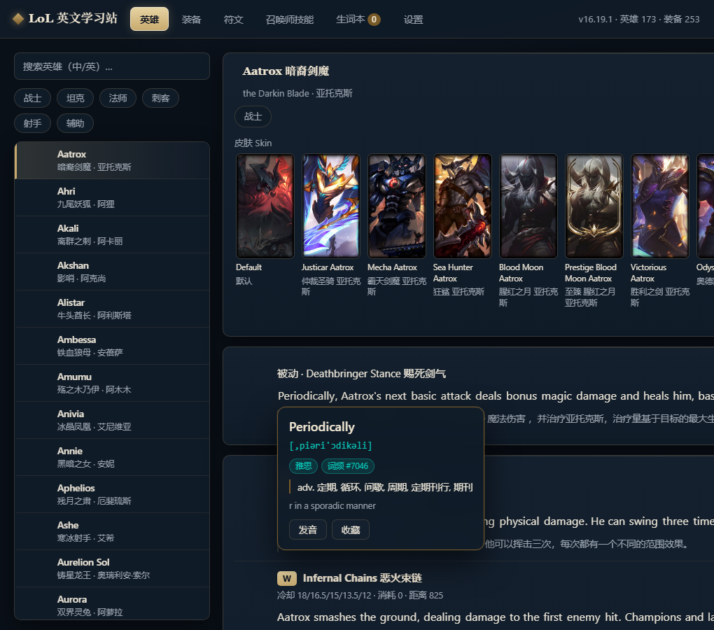

# 英雄联盟英文学习站 (LoL English)

借《英雄联盟》内容学习英文：把**英雄技能/被动、装备、皮肤名、召唤师技能、符文**做中英对照整理，
生僻词自动高亮，任意英文词可点击查看**音标、中文释义、考纲标签、词频**。



## 数据来源

- **英雄联盟官方数据库**：Riot Data Dragon（`zh_CN` / `en_US` 两种官方语言包）。
  所有游戏内文案（名称、描述）**直接取自官方库，未做机器翻译**；仅当某字段官方缺失时才自行补译。
- **词典**：开源英汉词典 [ECDICT](https://github.com/skywind3000/ECDICT)（音标、中文释义、考纲标签、词频、柯林斯星级）。

## 使用步骤

### 1. 一次性构建（需要 Node.js，联网）

```bash
npm install --omit=dev   # 构建只需一个依赖 csv-parse
npm run build            # 下载官方数据 + 词典，生成本地数据文件
```

构建产物在 `public/data/`。构建可**断点续传**：中途失败重跑会跳过已下载的内容；
原始下载物缓存在 `.cache/`，重复构建不会重新下载 65MB 词典。

### 2. 打开网站

**直接双击 `public/index.html` 即可**，无需启动任何服务器。

> 说明：小图标已下载到本地，核心内容完全离线可用；
> 皮肤大图（loading/splash）体积过大改为在线加载，断网时自动显示占位图。

### 3. 自检（可选）

```bash
npm install          # 安装 jsdom（dev 依赖）
npm run smoke        # 用 jsdom 真实加载页面，跑 24 项端到端断言
```

构建产物里 `public/data/report.js`、`report.dict.js` 含自检信息
（标记残留、英文中混入的中文、词典未收录词 Top 榜等），可直接阅读排查。

## 功能

- 英雄：搜索 + 按定位(tag)筛选，查看被动与 Q/W/E/R 技能的中英对照，皮肤缩略图点开看大图
  - 支持深链接，如 `index.html#/champions/Aatrox` 直达指定英雄（可加书签）
- 装备：按类型分组，展开查看双语描述
- 符文 / 召唤师技能：双语对照
- 生词标注：生僻词自动高亮；任意英文词点击弹出音标 + 中文释义 + 考纲标签 + 词频
- 发音：浏览器内置语音朗读单词（离线可用）
- 生词本：收藏生词，持久保存，可导出 JSON
- 设置：隐藏中文（自测模式）、高亮开关、语速、深色/浅色主题

## 目录

```
scripts/     构建脚本（Node，ESM）
public/      静态站点；双击 index.html 打开
  ├─ js/     前端脚本
  └─ data/   构建产物（自动生成）
.cache/      原始下载缓存（自动生成）
```

## 版权

仅供个人学习使用。游戏内容版权归 Riot Games 所有，遵循其 Legal Jibber Jabber；
词典数据遵循 ECDICT 自身开源协议。
